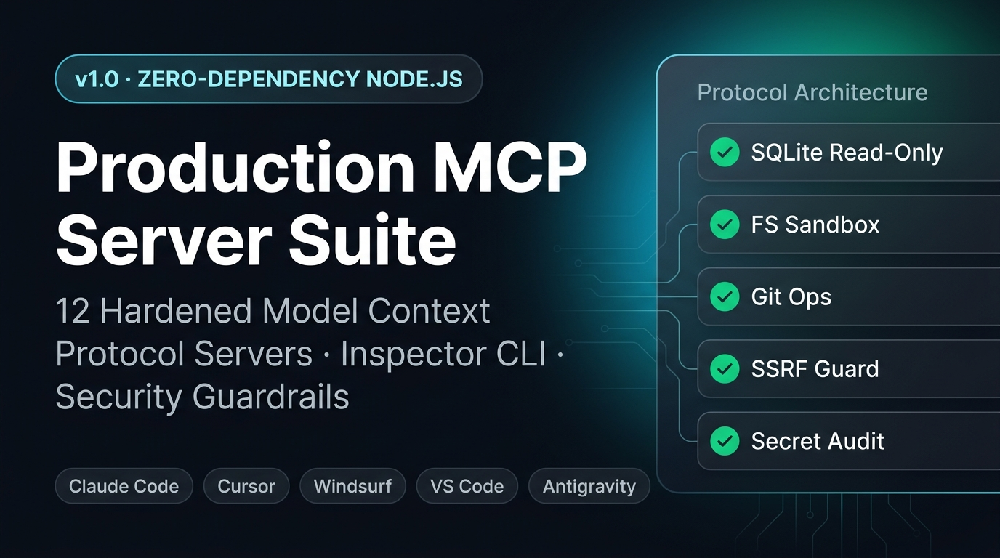

<p align="center">
  
</p>

# MCP Starter Suite Lite (Zero-Dependency Node.js)

**3 hardened, single-file Model Context Protocol (MCP) servers + a Universal MCP Stdio Inspector CLI — 100% free & MIT licensed.**

Zero `npm install`. Zero supply-chain bloat. Drop any `server.mjs` straight into **Claude Desktop**, **Claude Code**, **Cursor**, **Windsurf**, **VS Code Copilot**, or **Google Antigravity** (Node.js 18+/20+/22+/24+).

---

## Included Free in This Repo (MIT)

| Component | Description | Security Guardrails |
| :--- | :--- | :--- |
| **`servers/mcp-filesystem-sandbox/server.mjs`** | List workspace trees, read line ranges, search text & inspect file stats | Realpath symlink containment inside `SANDBOX_ROOT`; blocks `.env*`, `*.pem`, `*.key`, `id_rsa*`, `credentials.json` |
| **`servers/mcp-git-intelligence/server.mjs`** | Branch status, commit search, diff stats, churn hotspots & changelog drafter | Read-only git subcommands via `execFileSync` (zero shell interpolation) + strict ref allowlist |
| **`servers/mcp-env-security-auditor/server.mjs`** | Scans repos for leaked API keys/JWTs/private keys, checks `.env` drift & `.gitignore` hygiene | Always masks findings (`AKIA...CDEF`) — never echoes raw secrets into LLM context |
| **`tools/mcp-inspector-cli.mjs`** | Universal CLI to list & invoke tools on ANY stdio MCP server from your terminal | Pure Node.js JSON-RPC 2.0 client |

---

## Quickstart (30 Seconds)

Test any server immediately from your terminal — no dependencies to install:

```bash
# List tools exposed by the Git Intelligence MCP server
node tools/mcp-inspector-cli.mjs servers/mcp-git-intelligence/server.mjs list

# Inspect status of the current Git repo
node tools/mcp-inspector-cli.mjs servers/mcp-git-intelligence/server.mjs call git_status_summary '{}'

# Audit a repo for secret leaks & .gitignore hygiene
node tools/mcp-inspector-cli.mjs servers/mcp-env-security-auditor/server.mjs call check_gitignore_hygiene '{}'
```

### Add to Claude Desktop / Cursor / Antigravity
```json
{
  "mcpServers": {
    "mcp-filesystem-sandbox": {
      "command": "node",
      "args": ["/ABSOLUTE/PATH/TO/mcp-starter-suite-lite/servers/mcp-filesystem-sandbox/server.mjs"],
      "env": { "SANDBOX_ROOT": "/ABSOLUTE/PATH/TO/YOUR/PROJECT" }
    },
    "mcp-git-intelligence": {
      "command": "node",
      "args": ["/ABSOLUTE/PATH/TO/mcp-starter-suite-lite/servers/mcp-git-intelligence/server.mjs"],
      "env": { "GIT_REPO_PATH": "/ABSOLUTE/PATH/TO/YOUR/PROJECT" }
    },
    "mcp-env-security-auditor": {
      "command": "node",
      "args": ["/ABSOLUTE/PATH/TO/mcp-starter-suite-lite/servers/mcp-env-security-auditor/server.mjs"],
      "env": { "AUDIT_ROOT": "/ABSOLUTE/PATH/TO/YOUR/PROJECT" }
    }
  }
}
```

---

## Want All 12 Production MCP Servers? (PRO Suite)

Upgrade to **[Production MCP Server Suite v1.0 ($39 · Commercial & Agency License)](https://danlopes3.gumroad.com/l/production-mcp-suite)** to unlock all **12 hardened zero-dependency servers** + client configs + `SECURITY_ARCHITECTURE.md`:

1. `mcp-sqlite-analyst` (Read-only SQLite explorer + SQL write/DDL/PRAGMA blocker)
2. `mcp-filesystem-sandbox` (Path-jailed + symlink-verified workspace server)
3. `mcp-git-intelligence` (Git log, diff stats, hotspots & changelog drafter)
4. `mcp-github-ops` (Native-fetch GitHub issue/PR triage & repo health)
5. `mcp-http-api-tester` (DNS-verified SSRF-shielded REST/GraphQL tester)
6. `mcp-webhook-dispatcher` (HMAC-SHA256 signed webhook runner with retry backoff)
7. `mcp-csv-json-transformer` (CSV/JSON/JSONL schema, filter & group-by aggregator)
8. `mcp-log-detective` (Log error clusterer, stack-trace extractor & secret scrubber)
9. `mcp-markdown-knowledge` (Local docs/Obsidian search, frontmatter & `[[wikilink]]` graph)
10. `mcp-cron-task-planner` (5-field cron validator, next-runs & collision detector)
11. `mcp-env-security-auditor` (Secret leak scanner + `.env` drift & `.gitignore` check)
12. `mcp-prompt-memory-store` (Atomic persistent JSON agent memory with tags & TTL)

👉 **Get the full 12-Server Production Suite ($39):** https://danlopes3.gumroad.com/l/production-mcp-suite  
👉 **Also building n8n automations?** Check out our [AI Agency & DevOps Automation Vault (25 n8n Workflows + 3 MCPs — $29)](https://danlopes3.gumroad.com/l/ai-automation-vault) or its [free MIT Lite repo](https://github.com/danlopes18-ctrl/ai-automation-vault-lite).
---

### 🎁 Save $38 — Complete AI Engineering Stack Bundle ($79 vs $117)

Want all 3 zero-dependency developer suites together? Grab the **[Complete AI Engineering Stack Bundle ($79 · Commercial License)](https://danlopes3.gumroad.com/l/complete-ai-engineering-stack)**:
- **AI Agency & DevOps Automation Vault ($29)** — 25 standard-node n8n workflows + 3 MCP servers
- **Production MCP Server Suite ($39)** — 12 hardened zero-dependency Node.js MCP servers + Universal Inspector CLI
- **AI Coding Guardrails & Engineering OS ($49)** — 10 executable PreToolUse/PostToolUse hooks & OWASP CLIs + 8 rulebooks + 12 slash skills
